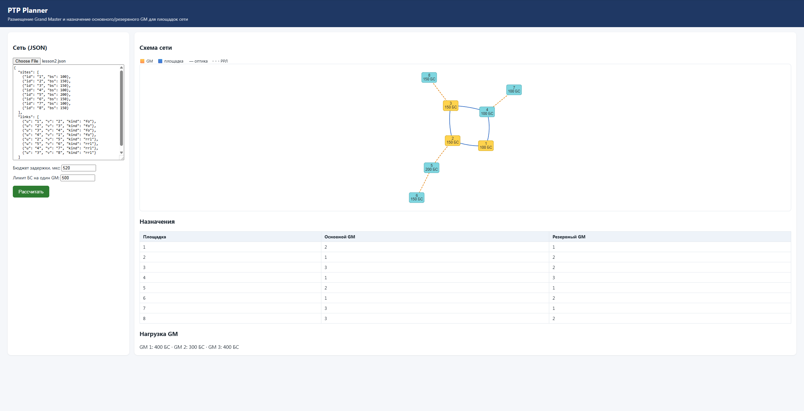

# PTP Planner


Веб-сервис для планирования синхронизации времени **PTP (IEEE 1588)** в транспортной сети мобильного оператора (Mobile Backhaul):

- рассчитывает задержку PTP-пути от источника времени до базовых станций;
- выбирает **минимальное число Grand Master (GM)** и площадки для них, с основным и резервным GM для каждой площадки и лимитом нагрузки на GM;
- строит **рейтинг модернизации линков** по эффекту на рубль, с учётом того, что путь часто требует модернизации сразу нескольких линков.

Проект сделан по мотивам кейса хакатона **МТС Engineer Hack 2026** (трек «Сетевой инженер-разработчик»). Данные МТС в репозиторий не входят, примеры в `examples/` учебные.



## Быстрый старт

Нужен только Docker:

```bash
git clone https://github.com/nayrest/ptp-planner.git
cd ptp-planner
docker compose up -d --build
```

Открыть в браузере: http://127.0.0.1:8000. Загрузить `examples/lesson2.json`, указать бюджет 520 мкс и нажать «Рассчитать».

Документация API (Swagger): http://127.0.0.1:8000/docs

## Как это работает

### 1. Задержка PTP-пути
Каждый маршрутизатор на пути вносит 20 мкс, оптический линк — 50 мкс, радиорелейный пролёт (РРЛ) — 190 мкс (150 мкс пролёт и два блока РРЛ по 20 мкс). Путь с минимальной задержкой ищется **алгоритмом Дейкстры** и проверяется на бюджет (по умолчанию 1500 мкс).

Минимальный по числу линков путь не всегда самый быстрый: в примере из `tests/test_paths.py` путь из 3 линков даёт 510 мкс, а путь из 4 линков — 440 мкс, потому что в первом два пролёта РРЛ.

### 2. Выбор Grand Master
- кандидаты — узлы, у которых есть хотя бы один оптический линк;
- нижняя граница числа GM: `max(2, ⌈число БС / лимит⌉)`;
- для каждого набора GM площадки распределяются так, чтобы у каждой были **основной и резервный** GM в пределах бюджета задержки, а нагрузка основного не превышала лимит (500 БС);
- возвращается минимальный набор, для которого такое распределение существует. Если у какой-то площадки резерв невозможен, сервис возвращает ошибку 400.

### 3. Рейтинг модернизации линков
Один линк часто не даёт эффекта сам по себе: путь заработает, только когда готовы все линки на нём. Поэтому кандидатами являются **пакеты**, то есть самые дешёвые наборы неготовых линков до каждой площадки (Дейкстра по стоимости, готовый линк стоит 0). На каждом шаге выбирается пакет с наибольшим отношением «прирост важности подключённых площадок / стоимость», его линки добавляются в рейтинг и считаются готовыми, и всё пересчитывается.

В учебном примере при бюджете 50 рейтинг пакетами подключает площадки с суммарной важностью **120**, а поштучный рейтинг — только **55** (`tests/test_rating.py`).

## API

| Метод | Путь | Что делает |
|---|---|---|
| GET | `/health` | Проверка, что сервис жив (используется в Docker healthcheck и CI) |
| POST | `/gm` | Выбор GM и назначение основного/резервного GM |
| POST | `/rating` | Рейтинг модернизации линков и эффект при бюджете |

Пример:

```bash
curl -X POST http://127.0.0.1:8000/gm \
  -H "Content-Type: application/json" \
  -d '{"sites":[{"id":"1","bs":100},{"id":"2","bs":150}],
       "links":[{"u":"1","v":"2","kind":"fo"}],
       "t_max":1500}'
```

### Формат сети

```json
{
  "sites": [{"id": "1", "bs": 100}],
  "links": [{"u": "1", "v": "2", "kind": "fo"}]
}
```

`kind`: `"fo"` — оптика, `"rrl"` — пролёт РРЛ. Для `/rating` у линков дополнительно указываются `id` и `cost`, у площадок `importance`, а в запросе — `gm` (узел, где стоит GM).

## Разработка

```bash
python -m venv .venv
.venv\Scripts\activate          # Windows
# source .venv/bin/activate     # Linux / macOS
pip install -r requirements-dev.txt

python -m pytest                # тесты
uvicorn ptp.api:app --reload    # сервер для разработки
```

## Стек

- **Python 3.13**, **FastAPI**, **Pydantic**
- **HTML / CSS / JavaScript**, визуализация графа — vis-network
- **pytest** — модульные тесты и тесты API
- **Docker**, **Docker Compose**, healthcheck
- **GitHub Actions** — тесты, сборка образа и smoke-тест контейнера при каждом push

## Структура

```
ptp/
  paths.py     — граф, Дейкстра, задержка пути
  loader.py    — загрузка сети из JSON
  gm.py        — кандидаты, таблица досягаемости, выбор GM
  rating.py    — рейтинг модернизации пакетами
  api.py       — FastAPI: эндпоинты и раздача страницы
static/        — веб-интерфейс (HTML, CSS, JS)
tests/         — тесты pytest
examples/      — учебные сети
.github/workflows/ci.yml — CI
```

## Ограничения и планы

- Выбор GM перебирает наборы кандидатов: подходит для небольших сетей. Для больших сетей планируется жадный алгоритм.
- Рейтинг в интерфейсе пока не выведен (доступен через API).
- Не учитывается режим N−1 (нагрузка на резервный GM при отказе основного).
- Планируется: загрузка GraphML, деплой на VPS с nginx и HTTPS, автоматический деплой из CI.